<div align="center">

  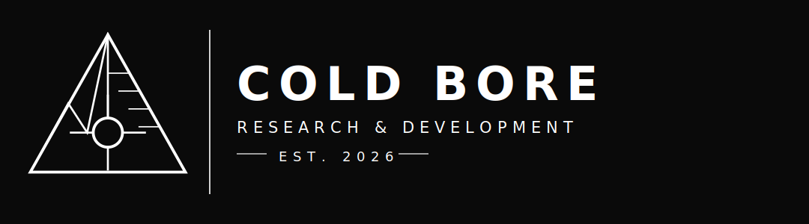

  <h1>Signal Atlas</h1>

  <p>
    See your Wi-Fi move through your house: a 3D digital twin with a live wave simulation,
    a calibrated signal map and the numbers behind it. Runs locally, changes nothing on your network.
  </p>

<p>
  
  
  
  <a href="LICENSE"></a>
</p>

<h4>
  <a href="#installation">Install</a>
  <span> · </span>
  <a href="#screenshots">Screenshots</a>
  <span> · </span>
  <a href="https://github.com/ColdBore-RD/signal-atlas/issues">Report Bug</a>
  <span> · </span>
  <a href="https://github.com/ColdBore-RD/signal-atlas/issues">Request Feature</a>
</h4>
</div>

<p align="center">
  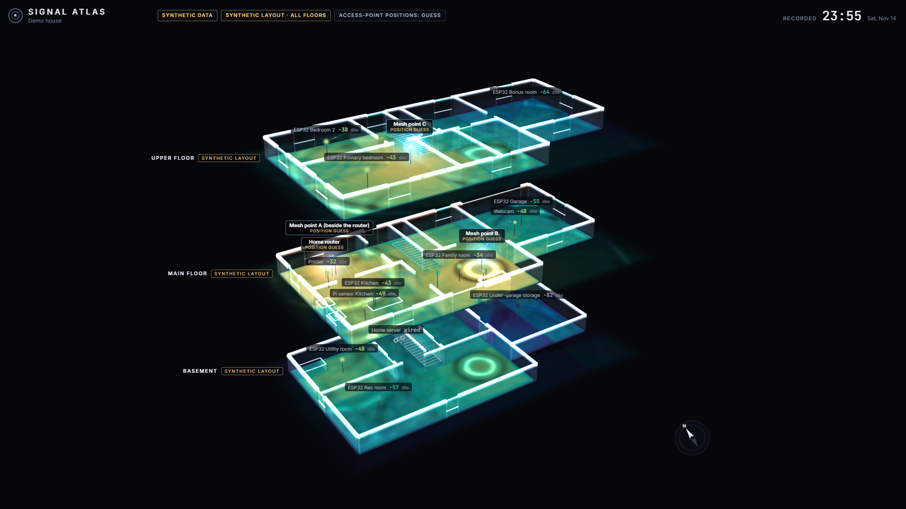
</p>

<br />

<!-- Table of Contents -->
<details>
<summary><strong>Table of Contents</strong></summary>

- [About the Project](#about-the-project)
- [How it works](#how-it-works)
- [Features](#features)
- [Getting Started](#getting-started)
- [Usage](#usage)
- [What is real and what is drawn](#what-is-real-and-what-is-drawn)
- [Screenshots](#screenshots)
- [Secrets](#secrets)
- [Tech Stack](#tech-stack)
- [Roadmap](#roadmap)
- [Contributing](#contributing)
- [FAQ](#faq)
- [Troubleshooting](#troubleshooting)
- [License](#license)
- [Contact](#contact)
- [Acknowledgements](#acknowledgements)

</details>

<!-- About the Project -->
## About the Project

**Signal Atlas shows where your Wi-Fi is strong, where it dies and why, on a 3D model of your own house.** Each access point sends a beacon pulse that spreads through the rooms, bends round doorways and fades through walls, drawn by a wave solver on your graphics card. Under the waves sits the signal level from a multi-wall model that you can calibrate by walking the house.

- **Your house, three ways in:** import a phone LiDAR scan (Polycam), trace a picture of your floor plan, or draw the rooms on a grid.
- **Honest numbers:** coverage, dead zones and room grades come from the calibrated model, and the page shows its own error against held-out measurements.
- **Display only and private:** it reads files and an optional read-only feed. It never changes a network setting, has no login, loads nothing from the internet, and has a privacy mode that makes screenshots safe to post.

**Status:** v0.1.0, first public release. The page, the layout editor, the setup panel and the walk survey (laptop and Raspberry Pi 4) are tested on Windows 11 with Chrome on an RTX 2060; every test below passes there except the 3 known layout-editor failures. The ESP32 sensor sketch and the MQTT bridge are written and unit-tested but have not run on hardware yet. Known layout-editor gaps are listed under [Roadmap](#roadmap).

<!-- How it works -->
## How it works

<div align="center">
  
</div>

<sub>Rendered from <a href="docs/images/signal-atlas-architecture.mmd">docs/images/signal-atlas-architecture.mmd</a>.</sub>

<!-- Features -->
## Features

| Part | What it does |
|---|---|
| 3D cutaway and 2D plan | Every floor of the house, exploded or one at a time, with walls, doors, windows and stairs |
| Wave simulation | 2D FDTD wave solver in WebGL2, all floors in one texture, joined at the stairwell. Three models: beacon pulses, pulses with energy-flow arrows, continuous tone |
| Signal map | Multi-wall propagation model (log-distance, loss per wall and per floor, per band), calibrated by ridge least squares on your measurements |
| Layers | Waves, envelope (strongest signal anywhere), fused, contour lines; 2.4 and 5 GHz; each network alone or the best of all |
| Metrics panel | Coverage per floor, dead zones, weakest and strongest room, model error, wired reference health, channel map |
| 24 h replay | Scrub or play back a recorded day; offline sensors and interference bursts show up |
| Layout editor (key `L`) | Scan import, plan tracing or grid drawing, with undo, levels, doors, windows and stairs. Saved to `data/user/` |
| Setup panel (key `D`) | Your networks, access points and devices, placed with a click on the plan. No reload |
| Walk survey (key `S`) | Click where you stand; a scanner logs every BSSID. Shows measured against predicted, the error, and where to measure next |
| Colour themes | Mission control, Aurora, Heat, Mono and a colour-blind safe theme, each checked for even steps and contrast |
| Privacy mode (key `P`) | Names, SSIDs, BSSIDs and the address are replaced, not blurred, before they are drawn |
| Sensors (Phase 2) | Raspberry Pi scanner, ESP32 RSSI sketch, MQTT-to-SSE bridge |

<!-- Getting Started -->
## Getting Started

<!-- Prerequisites -->
### Prerequisites

- [Node.js](https://nodejs.org/) 20 or newer. No `npm install` is needed to run the page.
- A browser with WebGL2: Chrome or Edge (tested); other WebGL2 browsers should work but are untested. On a laptop with two graphics chips, set the browser to the fast one.
- Optional, for scan import: Python 3 with `ezdxf numpy pillow shapely`.
- Optional, for the browser tests: Playwright (`npm install --no-save playwright`).

<!-- Installation -->
### Installation

```bash
git clone https://github.com/ColdBore-RD/signal-atlas.git
cd signal-atlas
node tools/serve.mjs
```

Open <http://127.0.0.1:8137/>. With no house of your own yet it shows the synthetic demo house.

For scan import, make a virtual environment once:

```powershell
python -m venv .venv
.\.venv\Scripts\python.exe -m pip install ezdxf numpy pillow shapely     # macOS/Linux: .venv/bin/python
```

<!-- Running Tests -->
### Running Tests

```bash
node --test tests/*.test.mjs                 # model, calibration, layout, setup, privacy, bridge, ...
node tools/verify/smoke.mjs                  # the page end to end in a browser
node tools/verify/layout-check.mjs           # the three ways into the layout editor
node tools/verify/layout-rattle.mjs          # the layout editor under abuse (3 known failures, see Roadmap)
node tools/verify/solver-tests.mjs           # the wave solver on the GPU
node tools/verify/privacy-check.mjs          # privacy mode shows none of the private strings
node tools/verify/check-colormap.mjs         # every colour theme
python -m unittest collectors/pi/test_scan.py collectors/pi/test_survey.py
```

The browser tools use Playwright's Chromium, or the installed Chrome or Edge (`ATLAS_BROWSER=chrome|msedge`), which draws on the real GPU even headless.

<!-- Usage -->
## Usage

```bash
node tools/serve.mjs              # your house if you made one, else the demo house
node tools/serve.mjs --live-sim   # the same with a simulated live feed
node tools/serve.mjs --public     # never serves data/private/
```

**Add your house.** Press `L` (or the Layout button) and pick a way in:

1. **Scan export.** Upload the DXF, CSV and GLB that Polycam exports for one floor. The page imports it, turns it north up and stacks the floors on the stairs.
2. **Plan image.** Upload a picture of a floor plan, set the scale on one known wall, and trace the rooms.
3. **Draw.** Draw rooms as rectangles or polygons on a grid, then add doors, windows and stairs.

Apply, and the atlas runs on your house at once. Then press `D` to add your networks and place your access points, and `S` to walk the house and calibrate. Details: [docs/custom-layout.md](docs/custom-layout.md), [docs/network-setup.md](docs/network-setup.md), [collectors/pi/SURVEY.md](collectors/pi/SURVEY.md).

<details>
<summary>Address flags and keys</summary>

| Address | Shows |
|---|---|
| `/?demo=1` | the synthetic demo house only |
| `/?layout=user` | the layout made in the Layout panel |
| `/?privacy=1` | privacy mode |
| `/?survey=1` | Survey mode |
| `/?setup=1` | the Setup panel |
| `/?theme=aurora` | a colour theme (`aurora`, `heat`, `mono`, `safe`) |
| `/?waves=beacon` | the wave model (`beacon`, `flow`, `tone`) |

For screenshots: `view=plan`, `level=1`, `layer=waves|envelope|fused|contours`, `band=5`, `quality=low|medium|high|ultra`, `orbit=0`, `reduced=1`, `ui=0`, `t=0.5` (time cursor at half the record).

Keys: Space pause, `.` step, `R` restart waves, `1`-`4` layer, `B` band, `N` network, `V` view, `W` wave model, `P` privacy, `L` layout, `D` setup, `S` survey, `M` reduced motion, `H` hide panels, `F` frame time, Alt+click reads plan coordinates.

</details>

<!-- What is real and what is drawn -->
## What is real and what is drawn

- **Wavelength is scaled ×10** so single wavefronts are visible, and the page says so. The waves show behaviour (reflection, doorway beams, diffraction, standing waves), not exact phase. The dBm numbers come from the calibrated model, never from the animation.
- **Each floor is a 2D slice.** Floors are joined at the stair opening; each access point also radiates into the other floors with the floor loss applied. The extra spreading loss a flat wave misses is worked out from the calibrated path-loss exponent, not set by hand.
- **Wall materials are assumptions** (typical 1990s wood-frame suburban construction), all in one table, [data/materials.json](data/materials.json). Calibration moves them toward what your measurements show.
- **Synthetic is labelled.** A floor that was not scanned says SYNTHETIC LAYOUT, a guessed access-point position says POSITION GUESS, and generated walk-test points never count as measured places.

<!-- Screenshots -->
## Screenshots

**The whole house in 3D** (demo house, Mission control theme, 1920×1080, RTX 2060).

<div align="center">
  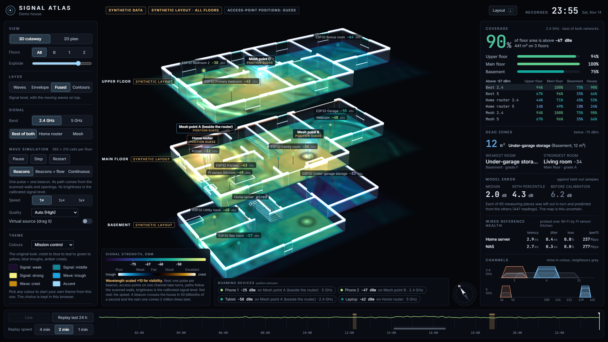
</div>

**One floor from above:** a beacon pulse from each access point spreading through walls and doors, and the same with energy-flow arrows.

<div align="center">
  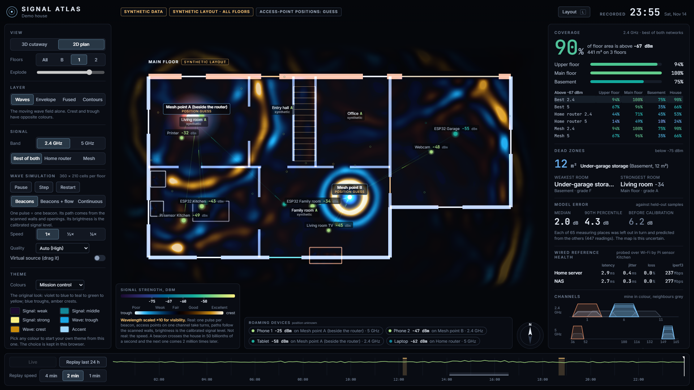
  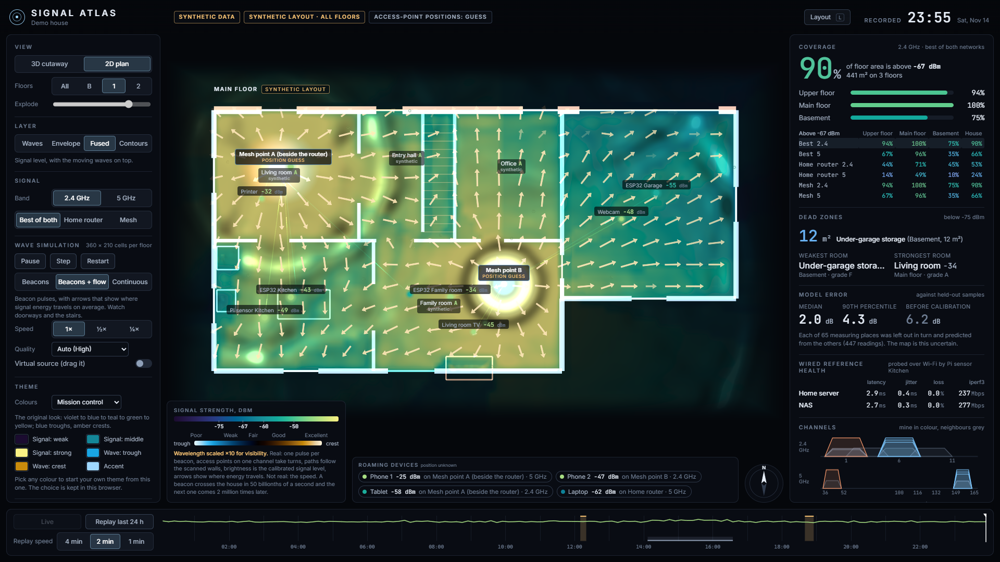
</div>

**Walk survey:** measured against predicted, the error numbers, hatching where nothing was measured within 4 m, and where to measure next.

<div align="center">
  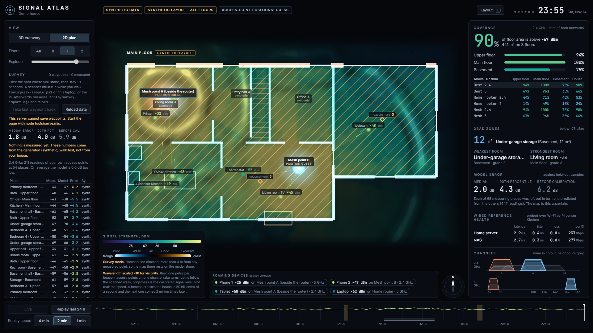
</div>

**Your own house:** draw it on a grid, apply, and the atlas runs on it.

<div align="center">
  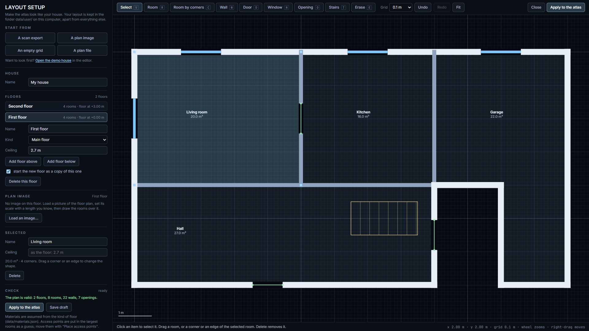
  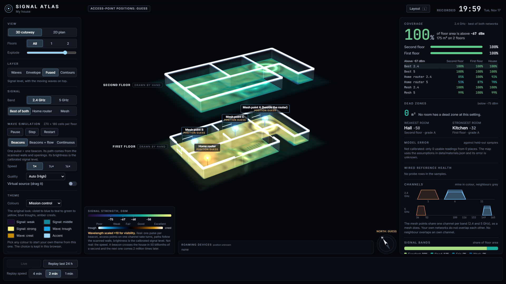
</div>

**Setup panel and privacy mode.**

<div align="center">
  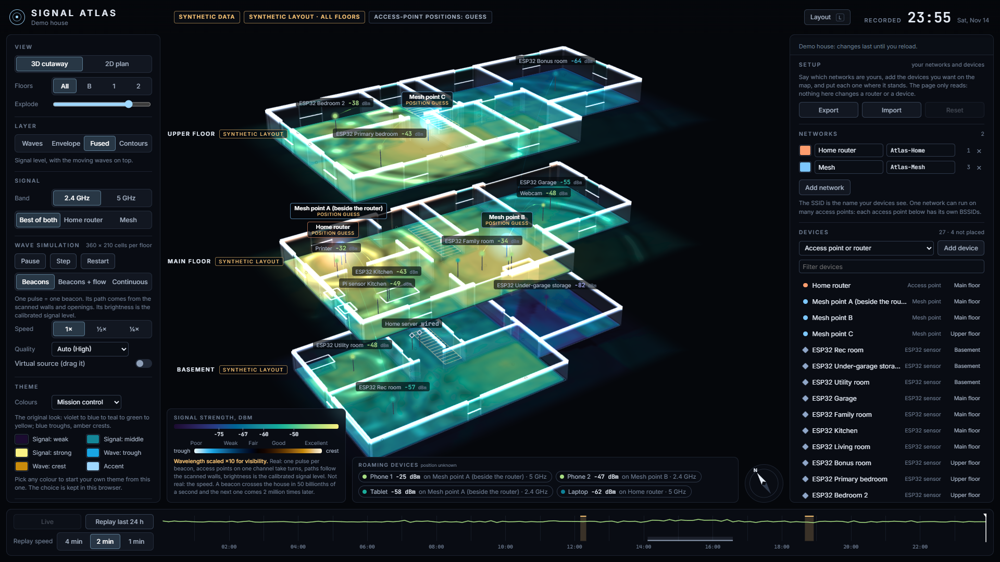
  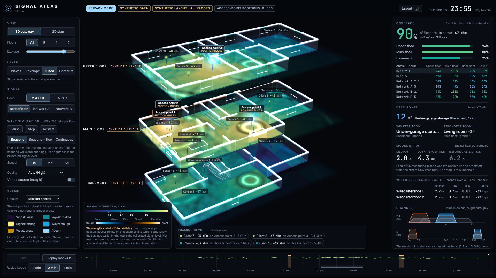
</div>

**Aurora theme.**

<div align="center">
  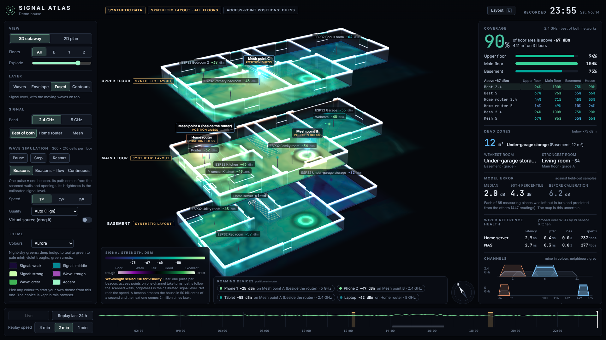
</div>

<!-- Secrets -->
## Secrets

Signal Atlas has no accounts, keys or cloud services. What is private is your house: its plan, SSIDs, BSSIDs, device MAC addresses and street address (Polycam exports carry the address and GPS position).

- Your layout and setup live in `data/user/`, and a scanned house in `data/private/`. Both are git-ignored, and `--public` mode never serves `data/private/`.
- Privacy mode replaces every private string before it is drawn or put into the page, so the page source holds nothing to recover.
- `node tools/verify/export-leak-check.mjs` checks that no scan address or position has been copied outside the scan folder.
- The ESP32 sketch reads Wi-Fi and MQTT credentials from `secrets.h` (git-ignored); copy `secrets.h.example`.

<!-- Tech Stack -->
## Tech Stack

<details>
  <summary>Page</summary>
  <ul>
    <li>Vanilla ES modules, no build step, no framework</li>
    <li><a href="https://threejs.org/">Three.js</a> 0.180 (vendored)</li>
    <li>WebGL2 float textures for the FDTD wave solver; a Web Worker for the signal grid</li>
    <li>Content-Security-Policy that blocks every outside request</li>
  </ul>
</details>

<details>
  <summary>Tools and server</summary>
  <ul>
    <li>Node.js 20+ dev server with a small file API for the layout, setup and survey</li>
    <li>Python with <a href="https://github.com/mozman/ezdxf">ezdxf</a>, NumPy, Pillow and Shapely for scan import</li>
    <li><a href="https://playwright.dev/">Playwright</a> for the browser tests</li>
  </ul>
</details>

<details>
  <summary>Sensors (Phase 2)</summary>
  <ul>
    <li>Raspberry Pi 4 scanner (Python, <code>iw</code>)</li>
    <li>ESP32 RSSI sketch (Arduino, <code>arduino-cli</code>)</li>
    <li>MQTT to Server-Sent Events bridge</li>
  </ul>
</details>

<!-- Roadmap -->
## Roadmap

* [x] 3D twin, wave solver and calibrated signal map on a synthetic house
* [x] Floor plan from Polycam LiDAR exports, north up, floors stacked
* [x] Layout editor: scan import, plan tracing, grid drawing
* [x] Setup panel for networks and devices
* [x] Walk survey with a laptop or a Raspberry Pi 4
* [ ] Layout editor: flag rooms that overlap and rooms too thin to be real
* [ ] Layout editor: keep the Layout button on screen on phone-width windows
* [ ] Layout editor: never derive a wall of zero length
* [ ] ESP32 sensors and the MQTT bridge on real hardware
* [ ] 6 GHz band

Changes are listed in [CHANGELOG.md](CHANGELOG.md).

<!-- Contributing -->
## Contributing

Issues and pull requests are welcome. Why things are the way they are is in [DECISIONS.md](DECISIONS.md). Before you open a PR:

- Keep it display only: nothing may change a network setting or send anything to a router.
- Never commit a real house. Test with the demo house or a made-up one; `data/private/` and `data/user/` stay out of git.
- Run `node --test tests/*.test.mjs` and, for page changes, `node tools/verify/smoke.mjs`.
- Add a line to [CHANGELOG.md](CHANGELOG.md).
- Keep README changes in line with the Cold Bore R&D README template.

<!-- FAQ -->
## FAQ

- **Do I need a LiDAR phone?**
  + No. Trace a picture of your floor plan or draw the rooms on a grid.
- **Does it need my router password or admin access?**
  + No. It only listens: a scan of the access points nearby, the same list your laptop shows.
- **Why are the waves so long?**
  + A real 2.4 GHz wave is 12 cm long, too short to see across a house. The animation uses a wave ten times longer and says so on screen.
- **How accurate is the signal map?**
  + The page tells you: the Model error box leaves each measured place out in turn and predicts it from the rest. On the demo house's simulated measurements the median is about 2 dB; that shows the calibration works, not how accurate it is in a real house. Walk your own house to get your number.

<!-- Troubleshooting -->
## Troubleshooting

<details>
<summary>Symptoms, causes and fixes</summary>

| Symptom | Cause | Fix |
|---|---|---|
| Low frame rate on a laptop | The browser runs on the built-in graphics chip | Set the browser to the fast GPU in the system graphics settings; press `F` to see the frame time |
| Black canvas, "WebGL2 not available" | Old browser, or GPU blocked | Use a current Chrome, Edge or Firefox; check `chrome://gpu` |
| Scan import says Python is missing | No `.venv` | Make the virtual environment under [Installation](#installation) |
| Walk scanner finds no networks (Windows 11) | Location services are off | Switch on Location services; Windows hides Wi-Fi scans without it |
| Model error is high after moving an access point | The samples were made for the old position | Walk the house again, or regenerate the demo samples: `node data/synthetic/generate.mjs` |

</details>

<!-- License -->
## License

Distributed under the MIT License. See [LICENSE](LICENSE) for more information.

<!-- Contact -->
## Contact

Cold Bore R&D. Questions, bugs and ideas: [GitHub issues](https://github.com/ColdBore-RD/signal-atlas/issues).

- Instagram: [@coldbore_rd](https://www.instagram.com/coldbore_rd/)

Project link: [https://github.com/ColdBore-RD/signal-atlas](https://github.com/ColdBore-RD/signal-atlas)

<!-- Acknowledgements -->
## Acknowledgements

- [Three.js](https://threejs.org/) for the 3D scene
- [Polycam](https://poly.cam/) for the LiDAR floor-plan exports the scan import reads
- [ezdxf](https://github.com/mozman/ezdxf) and [Shapely](https://github.com/shapely/shapely) for scan import
- [Shields.io](https://shields.io/) for the badges
- [Awesome README Template](https://github.com/Louis3797/awesome-readme-template) and [Awesome README](https://github.com/matiassingers/awesome-readme) for this README's layout
